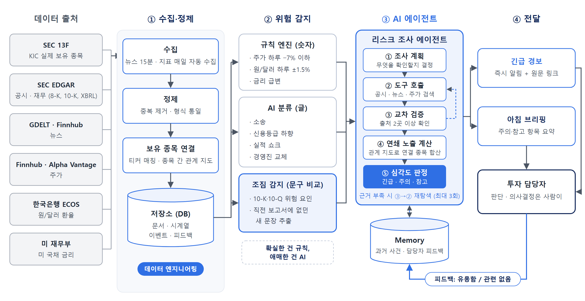

# 센티넬 (Sentinel)

### 보유 자산 리스크 조기경보 AI 에이전트

<br>

밤사이 터지는 보유 종목의 위험을 **감지**하고,<br>
에이전트가 직접 **조사·검증**한 뒤,<br>
포트폴리오 전체로 번지는 **노출 금액**까지 계산해 아침 전에 알려줍니다.

<br>

> 국부펀드 KIC, AI 에이전트 공모전 예선 기획 (2026.11 · 개인 참가)<br>
> 📄 [기획서 PDF 보기](docs/Sentinel_기획서.pdf)

<br>

---

<br>

## 1. 문제

### 주요 공시의 99.5%가 한국 업무시간 밖에 나온다

<br>

KIC 13F 상위 15종목의 1년치 SEC 공시를 직접 모아 분석했습니다.

<br>

| | |
|:---|---:|
| 1년간 나온 공시 | **28,688건** |
| 그중 주요 사건 공시 (8-K) | **184건 · 0.6%** |
| 8-K 중 한국 업무시간 밖 접수 | **183건 · 99.5%** |

<br>

담당자는 다음 날 아침에야 사건을 알게 되고,<br>
수만 건 중 무엇이 중요한지 직접 골라내야 합니다.

<br>

<p align="center">
  
  &nbsp;
  
</p>

<br>

---

<br>

## 2. 해결

### 조짐 감지 → 자율 조사 → 연쇄 노출 계산

<br>

<p align="center"></p>

<br>

**① 조짐 감지**<br>
연간 보고서의 위험 요인 문장을 작년과 비교해, 새로 생긴 위험을 먼저 잡습니다.

<br>

**② 이중 감지**<br>
확실한 숫자(주가 급락, 환율 급변)는 규칙으로, 애매한 글(소송, 경영진 교체)은 AI로 판단합니다.

<br>

**③ 자율 조사·검증**<br>
에이전트가 도구 8종 중 필요한 것을 골라 조사하고, 출처 2곳 이상에서 확인될 때만 경보합니다.

<br>

**④ 연쇄 노출 계산**<br>
종목 간 관계를 따라, 연결된 종목까지 합친 KIC 노출 금액 순으로 알립니다.

<br>

<p align="center"></p>

<br>

---

<br>

## 3. 실제 사례

### 두 회사의 공시를 한 사람으로 잇는다

<br>

2026년 4월 3일, 한국 시간 새벽에 실제로 접수된 공시입니다.

<br>

| 시각 | 공시 |
|:---:|:---|
| **05:18** | Alphabet, 회계책임자 *Amie Thuener O'Toole* 사임 |
| **06:25** | Broadcom, *Amie Thuener*를 새 CFO로 선임 |

<br>

키워드 알림이라면 서로 다른 알림 두 건으로 끝납니다.

센티넬은 직책과 이력으로 **두 사람이 같은 인물**임을 판단하고,<br>
두 회사를 **하나의 사건**으로 묶어 노출을 합산합니다.

<br>

| 종목 | KIC 보유 금액 | 비중 |
|:---|---:|---:|
| Alphabet | 26.5억 달러 | 5.0% |
| Broadcom | 12.1억 달러 | 2.3% |
| **합계** | **38.6억 달러** | **7.3%** |

<br>

<details>
<summary><b>에이전트 처리 과정 자세히 보기</b></summary>

<br>

| 시각 | 단계 · 도구 | 한 일과 판단 |
|:---:|:---|:---|
| 05:18 | 트리거 | 경영진 변동 공시(8-K Item 5.02)라 규칙이 조사를 시작 |
| | ① 조사 계획 | 사임 사유, 불화 여부, 후임과 이직처를 확인하기로 함 |
| | ② `search_filings` | 불화 없음 확인. 이직처가 없어 '확인 필요'로 대기 |
| 06:25 | 트리거 | Broadcom CFO 교체 공시 접수 |
| | `get_relations` | 이름 표기는 다르지만 직책·이력이 같아 동일 인물로 판정 |
| | `recall_memory` | 05:18 대기 건을 불러와 하나의 사건으로 묶음 |
| | ③ 근거 검증 | 두 회사 원문에서 근거 문장 확인 → 충분 |
| | ④ 판정 | 단독이면 '참고'지만 연결 노출이 커 '주의'로 올림 |
| 09:00 | 아침 브리핑 | 경보 목록 맨 위에 표시 |

<br>

**근거 원문**

- Alphabet: *"did not result from any disagreement with the Company"*
- Broadcom: *"has served as ... Chief Accounting Officer of Alphabet Inc."*

<br>

공시 시각·내용·보유 금액은 실제 자료이고, 처리 순서는 설계대로 재현한 것입니다.<br>
노출 금액은 규칙으로 계산하며 AI는 숫자를 만들지 않습니다.

</details>

<br>

### 아침 9시, 담당자가 받는 브리핑

<br>

밤사이 공시 3건이 경보 2건으로 정리되고, 노출 금액 순으로 정렬됩니다.

<br>

| 심각도 | 경보 | KIC 노출 |
|:---:|:---|---:|
| 🟠 주의 | Alphabet → Broadcom 회계책임자 이동 | 38.6억 달러 |
| ⚪ 참고 | Tesla 1분기 차량 인도 35.8만 대 발표 | 8.4억 달러 |

<br>

모든 경보에는 판정 이유와 원문 근거가 붙고,<br>
담당자의 피드백('도움됨' / '관련 없음')은 다음 판정에 반영됩니다.

<br>

---

<br>

## 4. 데이터 분석

### 기획의 모든 숫자는 이 저장소의 코드로 재현됩니다

<br>

| 분석 | 코드 |
|:---|:---|
| SEC 공시 1년치 수집 (15종목, 28,688건) | [`collect_filings.py`](src/collect_filings.py) |
| 접수 시각 분석 (업무시간 밖 99.5%) | [`analyze_timing.py`](src/analyze_timing.py) |
| 위험 요인 새 문장 찾기 (Apple 89문장) | [`diff_risk_factors.py`](src/diff_risk_factors.py) |

<br>

```bash
SEC_USER_AGENT="이름 연락처" python src/collect_filings.py
python src/analyze_timing.py
python src/diff_risk_factors.py AAPL
```

<br>

<details>
<summary><b>방법 자세히 보기</b></summary>

<br>

- **보유 종목:** KIC 13F(2026.6.30 기준)를 파싱하면 677종목이고, 상위 15종목이 37%를 차지합니다.
- **공시 수집:** EDGAR Submissions API의 최근 목록과 과거 페이지를 합치고, 접수번호로 중복을 제거했습니다.
- **시각 분석:** SEC 접수 시각(UTC)을 한국 시간으로 바꿔 평일 9~18시 밖인지 판단했습니다.
- **새 위험 문장:** 10-K의 위험 요인(Item 1A) 구간을 문장으로 나누고, 작년 어떤 문장과도 단어 유사도(Jaccard)가 0.5 미만이면 새 문장으로 봤습니다.
- **기획서 제작:** PowerPoint 자동화 스크립트로 공식 양식에 내용과 도표를 채웠습니다. 스크립트는 [`deck/build_deck.ps1`](deck/build_deck.ps1)에 있습니다.

<br>

Python 3.10 이상이면 외부 라이브러리 없이 실행됩니다.<br>
SEC 접근 정책에 따라 User-Agent를 밝히고 초당 10회 미만으로 호출합니다.

</details>

<br>

---

<br>

## 5. MVP 계획

<br>

| | |
|:---|:---|
| **범위** | KIC 상위 15종목 · 리스크 6종 · 데이터 출처 6곳 |
| **기술** | Python · PostgreSQL + pgvector · LangGraph · Claude API · Streamlit |
| **목표** | 놓친 사건 10% 이하 · 오경보 20% 이하 · 경보 15분 이내 |

<br>

---

<br>

## 저장소 구조

```
docs/      기획서 PDF, 도표 이미지
figures/   도표 원본 (SVG)
src/       수집·분석 코드
data/      수집 결과 (13F, 공시 목록, 10-K 본문)
deck/      기획서 자동 생성 스크립트
```

<br>

## 데이터 출처

- **SEC EDGAR** (13F, 8-K, 10-K) · 미국 정부 공개 데이터
- **KIC 운용자산** · 헤럴드경제 (2026.2.22)
- **참고 연구** · Cohen, Malloy, Nguyen (2020), *Lazy Prices*, Journal of Finance
