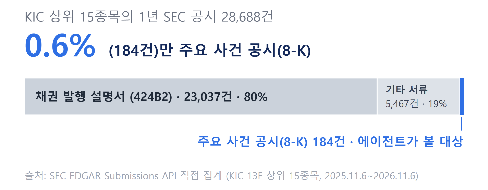
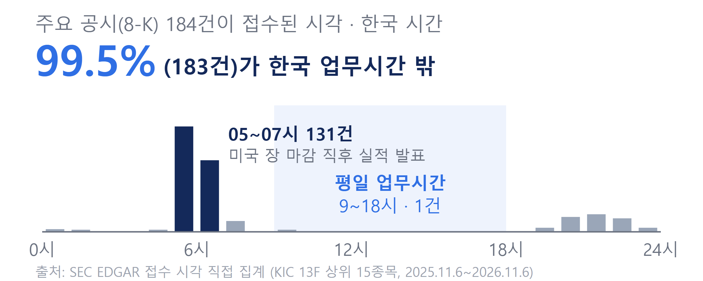
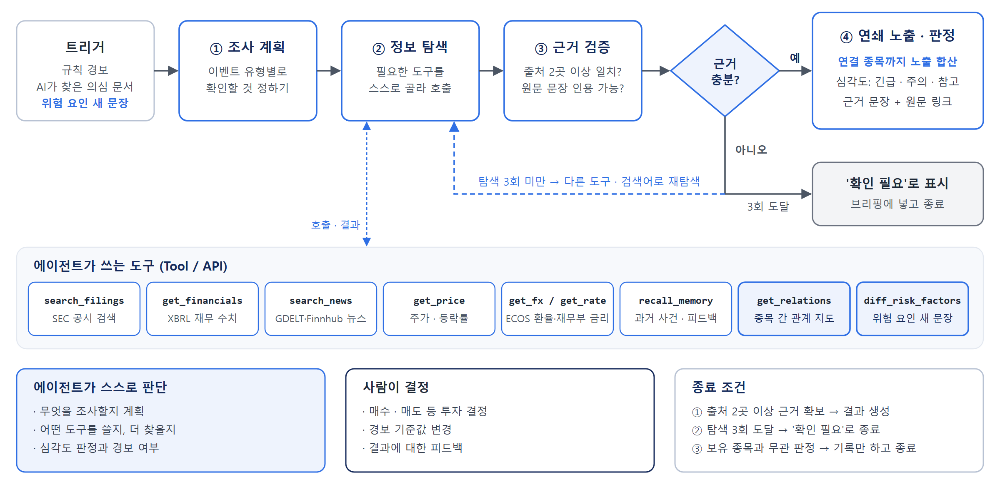

# 센티넬(Sentinel): 보유 자산 리스크 조기경보 에이전트

> 국부펀드 KIC, AI 에이전트 공모전 예선 기획서 (2026.11, 개인 참가)
> 📄 기획서 PDF: [docs/Sentinel_기획서.pdf](docs/Sentinel_기획서.pdf) (12쪽)

KIC가 보유한 해외 주식의 위험 신호를 **밤사이 감시하고**, 사건이 나면 에이전트가 **직접 조사·검증**한 뒤 **KIC 포트폴리오 전체로 번지는 노출 금액**까지 계산해 아침 전에 알려주는 AI 에이전트 기획입니다.

기획의 모든 숫자는 공개 데이터(SEC EDGAR, KIC 13F)를 직접 수집·집계해 만들었고, 이 저장소의 코드로 다시 재현할 수 있습니다.

---

## 1. 문제: 주요 공시의 99.5%가 한국 업무시간 밖에 나온다

KIC 13F 상위 15종목의 1년치 SEC 공시를 전부 모아 분석했습니다.

| 지표 | 값 |
|---|---|
| 1년 공시 (2025.11.6 ~ 2026.11.5) | **28,688건** |
| 그중 주요 사건 공시(8-K) | **184건 (0.6%)**, 나머지 80%는 채권 발행 설명서(424B2) |
| 8-K 중 한국 평일 9~18시 밖에 접수 | **183건 (99.5%)** |
| 한국 시간 새벽 5~7시 접수 | **131건** (미국 장 마감 직후 실적 발표) |

담당자는 다음 날 아침에야 사건을 알고, 수만 건 중 무엇이 중요한지 직접 골라야 합니다.

<p align="center"> </p>

## 2. 해결: 조짐 감지 → 자율 조사 → 연쇄 노출 계산

<p align="center"></p>

- **조짐 감지:** 연간 보고서(10-K)의 위험 요인(Item 1A) 문장을 작년과 비교해, 새로 생긴 위험 문장을 먼저 잡습니다.
  - 예: Apple 10-K(2026.11.3) 위험 요인에서 새 문장 89개를 찾았습니다. 그중 *"expects these trends to intensify for memory and storage"*는 보유 종목 Micron과 연결됩니다.
- **이중 감지:** 확실한 숫자(주가 급락, 환율 급변)는 규칙으로, 애매한 글(소송, 경영진 교체)은 AI로 판단합니다.
- **자율 조사·검증:** 에이전트가 도구 8종 중 필요한 것을 골라 조사하고, 출처 2곳 이상에서 확인될 때만 경보합니다. 3회 탐색에도 근거가 부족하면 '확인 필요'로 남깁니다.
- **연쇄 노출 계산:** 공시에서 뽑은 종목 간 관계 지도를 따라, 연결된 종목까지 합친 KIC 노출 금액 순으로 알립니다.

<p align="center"></p>

## 3. 실제 사례: 두 회사의 공시를 한 사람으로 잇는다

2026.4.3 한국 시간 새벽에 실제로 접수된 공시입니다.

- **05:18** Alphabet이 회계책임자 'Amie Thuener O'Toole'의 사임을 공시했습니다.
- **06:25** Broadcom이 'Amie Thuener'를 새 CFO로 선임한다고 공시했습니다.

키워드 알림이라면 서로 다른 두 건의 알림으로 끝납니다. 센티넬은 직책과 이력으로 둘이 같은 사람임을 판단하고, 두 회사를 하나의 사건으로 묶습니다.

### 에이전트가 한 일 (실제 공시 시각 기준 재현)

| 시각 | 단계 · 도구 | 한 일과 판단 |
|---|---|---|
| 05:18 | 트리거 | Alphabet 8-K Item 5.02 접수. 경영진 변동 항목이라 규칙이 조사를 시작 |
| | ① 조사 계획 | 확인할 것을 정함: 사임 사유, 회사와의 불화 여부, 후임과 이직처 |
| | ② `search_filings` | 원문에서 불화가 없음을 확인. 이직처는 공시에 없어 '참고·확인 필요'로 대기 |
| 06:25 | 트리거 | Broadcom 8-K Item 5.02 접수. 기존 CFO 은퇴, 후임으로 Amie Thuener 선임(6/12부) |
| | `get_relations` | 'Amie Thuener O'Toole'과 'Amie Thuener'를 직책·이력으로 같은 인물로 판정, 관계 지도에 두 회사를 연결 |
| | `recall_memory` | 05:18에 대기시킨 건을 불러와 하나의 사건으로 묶음 |
| | ③ 근거 검증 | 두 회사의 8-K 원문 두 곳에서 근거 문장 인용 확인 → 충분 |
| | ④ 연쇄 노출 · 판정 | 13F 기준 노출 합산(아래). 단독이면 '참고'지만 연결 노출이 커 한 단계 올려 '주의' |
| 09:00 | 아침 브리핑 | 경보 목록 맨 위에 표시 |

공시 접수 시각, 내용, 보유 금액은 실제 자료입니다. 분 단위 처리 순서는 설계대로 재현한 것입니다.

**근거로 붙는 원문 문장**
- Alphabet 8-K: *"did not result from any disagreement with the Company"*
- Broadcom 8-K: *"has served as Vice President, Corporate Controller and Chief Accounting Officer of Alphabet Inc."*

**KIC 노출 계산** (13F, 2026.6.30 기준)

| 종목 | 보유 금액 | 미국 주식 중 비중 |
|---|---:|---:|
| Alphabet | 26.5억 달러 | 5.0% |
| Broadcom | 12.1억 달러 | 2.3% |
| **합계** | **38.6억 달러** | **7.3%** |

노출 합산은 규칙으로 계산하고, AI는 숫자를 만들지 않습니다.

### 담당자가 아침 9시에 받는 브리핑 (같은 날 실제 공시로 구성)

밤사이 보유 종목 주요 공시 3건이 경보 2건으로 정리되고, KIC 노출 금액 순으로 정렬됩니다.

| 심각도 | 경보 | 근거 공시 | KIC 노출 |
|---|---|---|---:|
| 🟠 주의 (연쇄) | Alphabet → Broadcom 회계책임자 이동 | 8-K 2건 (05:18, 06:25) | 38.6억 달러 (7.3%) |
| ⚪ 참고 | Tesla 1분기 차량 인도 35.8만 대 발표 | 8-K Item 2.02 (4/2 22:07) | 8.4억 달러 (1.6%) |

- **긴급** 경보는 즉시 메신저로 보내고, **주의**와 **참고**는 이 브리핑에 정리합니다.
- 각 경보에는 판정 이유, 원문 근거 문장, 원문 링크가 붙습니다.
- 담당자가 '도움됨' 또는 '관련 없음'으로 피드백하면 다음 판정에 반영됩니다. '관련 없음'이 반복되는 유형은 심각도를 낮춥니다.

## 4. 데이터 파이프라인 (이 저장소에서 재현 가능)

| 단계 | 내용 | 코드 |
|---|---|---|
| 보유 종목 | KIC 13F(2026.6.30 기준) 파싱 → 677종목, 상위 15종목 비중 37% | `data/infotable.xml` |
| 공시 수집 | EDGAR Submissions API로 15종목 1년치 공시 수집 (과거 페이지까지 병합, 접수번호 중복 제거) | [`src/collect_filings.py`](src/collect_filings.py) |
| 시각 분석 | 접수 시각(UTC) → 한국 시간 변환, 업무시간 밖 비율과 시간대 분포 | [`src/analyze_timing.py`](src/analyze_timing.py) |
| 조짐 감지 | 10-K Item 1A 구간 추출 → 문장 분리 → 단어 Jaccard 유사도 0.5 미만을 새 문장으로 판정 | [`src/diff_risk_factors.py`](src/diff_risk_factors.py) |
| 기획서 제작 | PowerPoint COM 자동화로 공식 양식에 내용·도표를 채워 pptx/pdf 생성 | [`deck/build_deck.ps1`](deck/build_deck.ps1) |

```bash
# Python 3.10+, 외부 라이브러리 없음
SEC_USER_AGENT="이름 연락처" python src/collect_filings.py   # data/filings_all.csv, data/8k_list.csv
python src/analyze_timing.py                                 # 28,688건 / 184건 / 99.5%
python src/diff_risk_factors.py AAPL                         # 새 위험 문장 89개
```

SEC 공정 접근 정책에 따라 User-Agent를 밝히고 초당 10회 미만으로 호출합니다.

## 5. MVP 계획 (본선)

- **범위:** KIC 상위 15종목, 리스크 이벤트 6종, 데이터 출처 6곳
- **기술:** Python, PostgreSQL + pgvector, LangGraph, Claude API, Streamlit, GitHub Actions(15분 주기 수집)
- **평가 지표:**
  - 놓친 사건 비율 10% 이하
  - 오경보율 20% 이하
  - 근거 일치율 100%
  - 경보 지연 15분 이내
  - 관계 지도 정확도 90% 이상

## 저장소 구조

```
├── docs/            기획서 PDF, 도표 이미지
├── figures/         도표 원본 (SVG)
├── src/             수집·분석 코드
├── data/            수집 결과 (13F, 공시 목록, 10-K 본문, 새 위험 문장)
└── deck/            기획서 자동 생성 스크립트 (공식 양식 pptx는 미포함)
```

## 데이터 출처

- **SEC EDGAR** (13F, 8-K, 10-K): 미국 정부 공개 데이터이며 재사용할 수 있습니다.
- **KIC 운용자산:** 헤럴드경제(2026.2.22) 보도를 참고했습니다.
- **참고 연구:** Cohen, Malloy, Nguyen (2020), *Lazy Prices*, Journal of Finance 75(3). 보고서 문구 변화가 미래 위험을 예고한다는 연구입니다.

기획서에는 민감정보, 개인정보, API Key가 포함되어 있지 않습니다.
